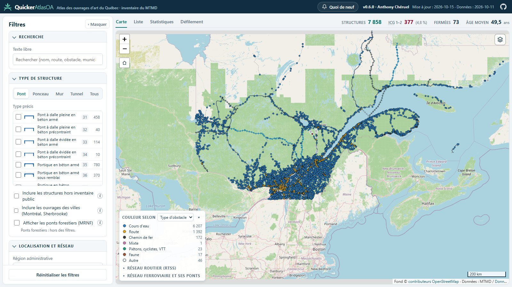

# QuickerAtlasOA — l’atlas des ponts du Québec

*[English version](README.md)*

**[▶ Ouvrir l’atlas](https://acfakkoh.github.io/QuickerAtlasOA/)** — gratuit, sans compte, dans le navigateur.

QuickerAtlasOA affiche sur une carte les **≈ 11 700 ouvrages d’art** du ministère des Transports et de la Mobilité
durable du Québec (MTMD) : ponts, ponceaux, murs et tunnels. Il reprend l’inventaire public du Ministère et le rend
plus rapide à explorer.

## Ce que vous pouvez faire

- **Chercher et filtrer** : par nom, route, cours d’eau, municipalité, région, type de pont, année, longueur,
  état (ICG), restrictions (IAS), limitation de poids ou de hauteur.
- **Lire la fiche d’un ouvrage** : photo, dimensions, état, dernière inspection, trafic, liens vers la fiche et le
  rapport d’inspection officiels du MTMD, et vers Wikipédia pour environ 160 ponts connus.
- **Changer de point de vue** : carte, liste exportable (CSV), statistiques cliquables, défilement photo par photo, ou
  liste des **ponts remarquables du Canada** (Wikipédia) : étoiles dorées sur la carte, hors filtres et statistiques.
- **Ajouter des couches** : réseau routier et ferroviaire, cours d’eau, sondages géotechniques, aléa sismique et
  classes de site, autres ponts hors MTMD (forestiers, municipaux…), ouvrages des villes de Montréal et Sherbrooke.
- **Outils d’ingénierie** (dans la fiche) : profil LiDAR (hauteur sous l’ouvrage, pentes), cours d’eau et débits au
  pont, aléa sismique du code national du bâtiment.

Chaque vue garde ses filtres dans l’adresse : copiez le lien pour partager exactement ce que vous voyez.

## D’où viennent les données ?

Uniquement de **données ouvertes** : inventaire des structures du MTMD et Données Québec (CC-BY 4.0), LiDAR de
Ressources naturelles Canada, OpenStreetMap, MRNF, CNBC 2020, Wikipédia (CC BY-SA) et Wikidata (CC0). Elles sont mises à jour périodiquement ; la date figure
en haut à droite de l’atlas.

> Projet personnel et indépendant, **non affilié au MTMD**. Les valeurs affichées servent à l’exploration : pour toute
> décision, la fiche officielle du Ministère et les normes en vigueur font foi.

---

Développeurs : mise à jour des données, sources et architecture dans [docs/TECHNIQUE.md](docs/TECHNIQUE.md).
Auteur : Anthony Chéruel.
