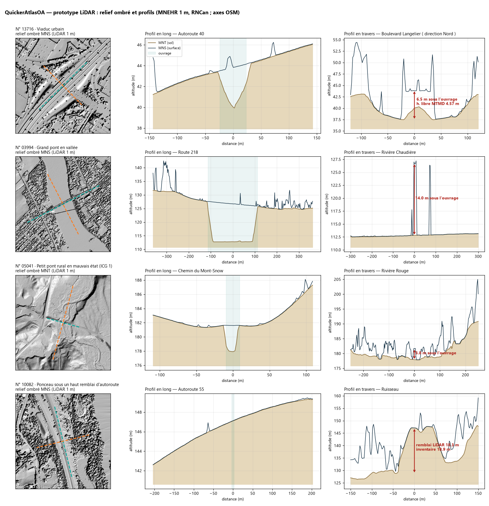

# Prototype LiDAR : relief ombré et profils en long autour des structures (2026-10-11)

**Verdict** : l'idée tient. Le relief ombré s'intègre gratuitement, en tuiles WMS de RNCan, sans rien héberger. Les profils peuvent être calculés **à la demande dans le navigateur**, en 3 à 11 s par structure, car le WCS de RNCan accepte les requêtes CORS. Sur 4 cas types, les mesures sont cohérentes avec l'inventaire du MTMD, à condition de contourner un piège : sous un tablier, le MNT est interpolé.

Fichiers :
- `prototypes/lidar/prototype-lidar.html` (s'ouvre via `python -m http.server`) ;
- `prototypes/lidar/proto_lidar.py` ;
- `prototypes/lidar/planche_prototype_lidar.png`.

## Données utilisées

- **MNEHR 1 m** (modèle numérique d'élévation de haute résolution, LiDAR aérien) de Ressources naturelles Canada, Licence du gouvernement ouvert – Canada. Deux modèles : **MNT** = sol nu, **MNS** = surface, tablier compris.
  - WMS `dtm-hillshade`, `dsm-hillshade`, `dtm-slope`… en EPSG:3857 (WMS 1.3.0).
  - WCS 1.1.1 en GeoTIFF flottant : environ 250 Ko pour 300 × 300 m, résolution d'environ 1,2 m.
  - Couverture : tout le Québec méridional.
- **Axe des ouvrages** : chemins OpenStreetMap (API Overpass), car l'inventaire du MTMD ne donne ni axe ni orientation. Repli : l'axe principal des pixels surélevés (MNS − MNT > 2,5 m), c'est-à-dire le tablier lui-même.

## Les 4 cas

| Cas | Structure | Mesures LiDAR | Comparaison et intérêt |
|---|---|---|---|
| Viaduc urbain | **13716**, A-40 au-dessus du boul. Langelier (dalle évidée, 1964, tablier 47,3 m) | Tablier 43,9 m · route du dessous 37,5 m → **6,5 m** sous l'ouvrage | Hauteur libre MTMD 4,57 m → **≈ 1,9 m** pour le tablier, la chaussée et le dévers : ordre de grandeur cohérent, à ± 0,3 m près. Le MNT interpolé sous le tablier (39,9 m) aurait faussé la hauteur de 2,5 m. |
| Grand pont en vallée | **03994**, route 218 sur la Chaudière (1960, tablier 224 m) | Tablier à **14,0 m** au-dessus de l'eau · vallée de 13 m · approche à 4,6 % | Lecture du site sans visite : revanche, accès aux appuis, pentes. Un second ouvrage parallèle est visible au MNS. |
| Petit pont rural ICG 1 | **05041**, ch. du Mont-Snow sur la rivière Rouge (1975, 18,4 m) | Tablier à **3,8 m** au-dessus de l'eau · plaine inondable plate · approche aval à 6,7 % | Le relief ombré du MNT montre le lit, les anciens méandres et les talus : contexte hydraulique (affouillement, revanche) visible en un coup d'œil. |
| Ponceau sous remblai | **10082**, A-55 sur un ruisseau (remblai inscrit 14,3 m, ouverture 4,6 m) | Chaussée 147,1 m · pied du remblai 128,8 m → **18,3 m** | Inventaire : 14,3 + 4,6 = 18,9 m, soit **0,6 m d'écart**. On peut contrôler automatiquement les épaisseurs de remblai des ~2 800 ponceaux. |

## Essai en direct (dans la page)

Saisir un n° de structure : la page lance en parallèle les deux WCS (MNT, MNS) et Overpass, décode le GeoTIFF en JavaScript (une soixantaine de lignes, sans librairie), puis trace la carte et les profils.

- **18649N** (A-40 / A-73, Québec) : 11 s.
- **07824** (A-40 / rivière Rigaud) : 3 s.

Aucune donnée n'est précalculée : la fonction pourrait entrer telle quelle dans la fiche, derrière un bouton « Profil LiDAR ».

## Limites constatées

1. **Sol interpolé sous les tabliers** : le LiDAR ne voit pas sous un pont. On lit donc l'obstacle dans le profil en travers, juste à côté du tablier (3 à 20 m au-delà de la demi-largeur).
2. **Routes à deux chaussées sous l'ouvrage** : le profil en travers peut tomber dans le terre-plein ou le fossé. L'épaisseur estimée est alors trop forte (18649N : 3,2 m). Correctif : lire l'altitude sur l'axe OSM de la route du dessous plutôt que sur la perpendiculaire.
3. **Cours d'eau** : le MNT donne la surface de l'eau au moment du levé, pas le lit. La « hauteur au-dessus de l'eau » dépend donc du niveau ce jour-là.
4. **Dates des levés** variables selon les régions (2018–2025 pour la mosaïque 1 m) : un ouvrage reconstruit depuis peut ne pas correspondre.
5. **Dépendance à deux services externes** (RNCan, Overpass). Overpass a renvoyé des 504 passagers ; une nouvelle tentative et le repli par l'axe LiDAR les absorbent.

## Proposition d'intégration (si validée)

1. **v0.6** : fonds « Relief ombré MNT / MNS (LiDAR) » dans le menu des fonds. C'est trivial : 2 tuiles WMS, rien à héberger.
2. **v0.6** : section « Profil LiDAR » dans la fiche, calculée à la demande, avec profils en long et en travers, hauteur sous l'ouvrage et, si une hauteur libre est connue, l'estimation tablier + chaussée.
3. **Plus tard** : calcul par lots (ETL) des mesures pour toutes les structures, afin de repérer les incohérences de l'inventaire : remblais des ponceaux, hauteurs, longueurs (environ 9 900 × 2 requêtes, quelques heures à 1 requête par seconde).
